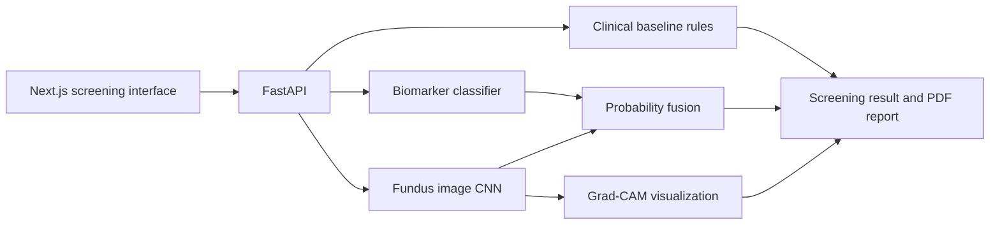

# Diabetic Retinopathy Early Detection

A research prototype for early diabetic retinopathy (DR) screening. It explores how retinal fundus images and patient clinical measurements can be used together to estimate DR severity and help prioritize cases for review. The repository contains model training code, a FastAPI inference service, and a Next.js screening interface.

> **Research use only.** This software is not a medical device and is not intended to diagnose disease or guide treatment. Predictions must be reviewed by a qualified clinician and must not replace a comprehensive eye examination.

## Problem this project addresses

DR severity is assessed from retinal findings, while patient measurements can provide additional context for screening. This project investigates a software workflow that accepts a retinal fundus image and clinical measurements, estimates one of five DR grades, and presents a risk-based screening priority. It is intended as a research and engineering project; this repository does not establish clinical performance or validate that the workflow improves patient outcomes.

## Proposed workflow

The combined prediction workflow brings together three kinds of output:

1. **Clinical baseline:** a transparent, rule-based score from selected measurements. It produces a recommendation to proceed to fundus imaging or continue routine monitoring.
2. **DR grade estimate:** a five-class image model, a clinical biomarker classifier, or a weighted combination of both model probability outputs.
3. **Review aids:** class probabilities, a severity-weighted risk score, a screening priority, and Grad-CAM visualization for image-based predictions.

For combined screening, the image and biomarker probabilities are combined using weights from `src/config/settings.yaml` (currently 0.6 and 0.4). Severe or proliferative outputs from either model can trigger an urgent priority in the fusion logic. The clinical baseline score is reported separately; it is not part of the probability fusion. The screening interface is at `/screening` and can display results and request a PDF report. `/history` is currently a placeholder page; it does not store or display screening records.

This repository includes labeled fundus images under `raw_combined/`, but does not include a patient-level clinical biomarker dataset or tracked trained model weights. Local files under `saved_models/` may be present in a developer's checkout, but they are not a dependable part of a fresh clone. The project has no documented clinical validation. Predictions depend on the provenance and quality of data used to train the local models; demo or synthetic-data results are not evidence of diagnostic accuracy.

### DR grades

| Grade | Classification | Summary |
| --- | --- | --- |
| 0 | No DR | No visible diabetic retinopathy |
| 1 | Mild NPDR | Microaneurysms only |
| 2 | Moderate NPDR | More than microaneurysms, below severe criteria |
| 3 | Severe NPDR | Severe non-proliferative retinopathy |
| 4 | Proliferative DR | Proliferative retinopathy |

## Architecture



## Repository layout

```text
api/                  FastAPI routes, request schemas, screening prioritization
frontend/             Next.js and TypeScript web application
src/config/           Model, preprocessing, and screening configuration
src/data_prep/        Image and tabular data preparation
src/models/           Biomarker model, retinal CNN, and probability fusion
src/pipeline/         Training and evaluation workflows
src/explainability/   Grad-CAM implementation
notebooks/            Exploratory analysis and model prototyping
tests/                API and model tests
raw_combined/         Labeled retinal fundus images, arranged by grade (0-4)
data/                 Local clinical data and generated artifacts (not included)
saved_models/         Local model artifacts (created during training; not tracked)
```

## Requirements

- Python 3.11 (used by the API Docker image)
- Node.js 22 and npm (for the frontend)
- Retinal image and clinical datasets for training
- Trained model artifacts in `saved_models/` for prediction

Install Python dependencies from the repository root:

```bash
python -m venv .venv
```

Activate the environment, then install the pinned packages:

```powershell
# Windows PowerShell
.venv\Scripts\Activate.ps1
pip install -r requirements.txt
```

```bash
# macOS / Linux
source .venv/bin/activate
pip install -r requirements.txt
```

Install and start the frontend in a separate terminal:

```bash
cd frontend
npm ci
```

Create `frontend/.env.local` with the API URL:

```dotenv
NEXT_PUBLIC_API_BASE_URL=http://localhost:8000
```

Then run the development server:

```bash
npm run dev
```

Open `http://localhost:3000/screening` to use the screening form.

## Data and model setup

The repository contains labeled fundus images under `raw_combined/raw_combined/`, grouped into grade folders (`0` through `4`). The CNN loader defaults to `raw_combined/` and scans for those class folders. Verify the image labels, dataset provenance, and any applicable usage terms before training. Keep patient-identifiable clinical data local and do not commit it.

Clinical training data is read from `data/raw/clinical_data.csv` by default. It should include the configured clinical features and a `dr_grade` target (integer grades 0-4). **Important:** if the file is missing or does not meet the loader's class-count requirements, the current preprocessing code generates synthetic clinical data. Check the training output and `src/data_prep/tabular_prep.py` before training; a model trained on generated data is for pipeline development only and is not clinically meaningful. Model artifacts are written to `saved_models/` and are not tracked by Git. Image inference requires CNN weights; biomarker inference requires a classifier and scaler. Train the required models in your checkout before using these prediction routes.

The repository also includes a random-data generator:

```bash
python create_dummy_data.py
```

This creates random sample data for development only. It is not a correctly labeled clinical dataset and must not be used to claim model performance or make screening decisions.

## Train and evaluate

Train both model pipelines using their defaults:

```bash
python -m src.pipeline.train --model all
```

Train one model at a time:

```bash
python -m src.pipeline.train --model biomarker
python -m src.pipeline.train --model cnn --data_dir raw_combined
```

For a quicker CNN development run, limit the number of images used per grade:

```bash
python -m src.pipeline.train --model cnn --subset 200 --epochs 2 --fine_tune_epochs 0
```

The training CLI also supports `--backbone`, `--batch_size`, and `--force` (for biomarker retraining). Review `TRAINING_GUIDE.md` and the pipeline options before starting a full training run.

Evaluate the configured biomarker and image datasets:

```bash
python -m src.pipeline.evaluate
```

Evaluation requires the relevant datasets and trained model artifacts. Results and model output paths are controlled by the pipeline and configuration files.

## Run the API

From the repository root, start FastAPI:

```bash
uvicorn api.main:app --reload --host 0.0.0.0 --port 8000
```

Interactive API documentation is available at `http://localhost:8000/docs`. Check service and model loading with:

```bash
curl http://localhost:8000/health
```

### Endpoints

| Method | Endpoint | Input |
| --- | --- | --- |
| `GET` | `/health` | None; reports service status and loaded models |
| `POST` | `/predict/biomarker` | JSON object containing a `biomarkers` object |
| `POST` | `/predict/image` | Multipart form field `file` with a fundus image |
| `POST` | `/predict/unified` | Multipart `file` and the required clinical form fields |
| `POST` | `/predict/unified/report` | Same as unified prediction; returns a PDF download |
| `POST` | `/predict/batch` | Multipart CSV file of patient rows |

Example biomarker request:

```bash
curl -X POST http://localhost:8000/predict/biomarker \
  -H "Content-Type: application/json" \
  -d '{
    "biomarkers": {
      "age": 58,
      "bmi": 28.5,
      "hba1c": 8.2,
      "blood_pressure_systolic": 145,
      "blood_pressure_diastolic": 92,
      "cholesterol_total": 240,
      "cholesterol_hdl": 42,
      "cholesterol_ldl": 160,
      "triglycerides": 200,
      "diabetes_duration_years": 12,
      "smoking_status": 1,
      "family_history_dr": 1
    }
  }'
```

The response includes a predicted grade and label, per-grade probabilities, a risk score, a screening tier, and the model used. Image and unified predictions can include Grad-CAM heatmap and overlay data URLs. The batch endpoint accepts CSV input; see `api/main.py` for supported column aliases and defaults.

## Docker Compose

The repository includes a Compose configuration for the API and frontend:

```bash
docker compose up --build
```

The frontend is served on port `3000` and the API on port `8000`. The API container mounts `saved_models/` read-only, so add the required trained artifacts locally before expecting predictions to succeed. The frontend API URL is set at image build time with `NEXT_PUBLIC_API_BASE_URL`. Compose also accepts `CORS_ORIGINS`, `MAX_FILE_SIZE_MB`, `TIER_URGENT_THRESHOLD`, and `TIER_MODERATE_THRESHOLD` environment variables.

## Configuration

`src/config/settings.yaml` contains the default image dimensions and preprocessing settings, clinical feature names, CNN backbone and training values, biomarker model parameters, fusion weights, screening tier thresholds, and baseline recommendation threshold. The API and training pipelines read from this configuration.

## Technology

- **API:** FastAPI, Pydantic, Uvicorn
- **Web application:** Next.js, React, TypeScript, Tailwind CSS
- **Modeling:** TensorFlow/Keras, scikit-learn, XGBoost
- **Image processing:** OpenCV, Pillow, Albumentations
- **Explainability and reports:** Grad-CAM, ReportLab

## License

No license file is currently included. Contact the repository owner for licensing and reuse terms.
